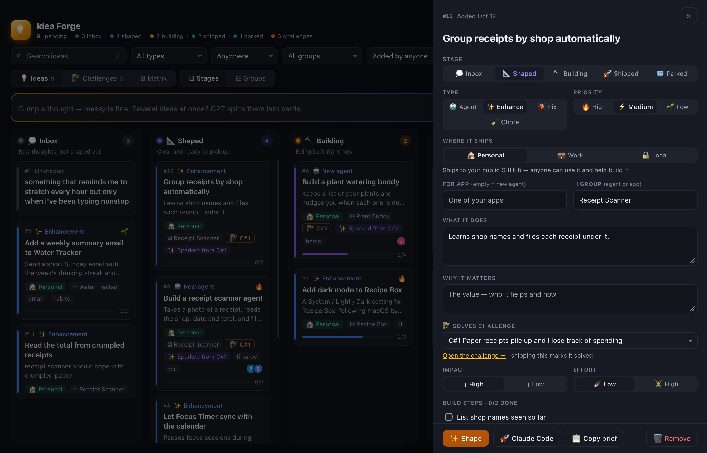
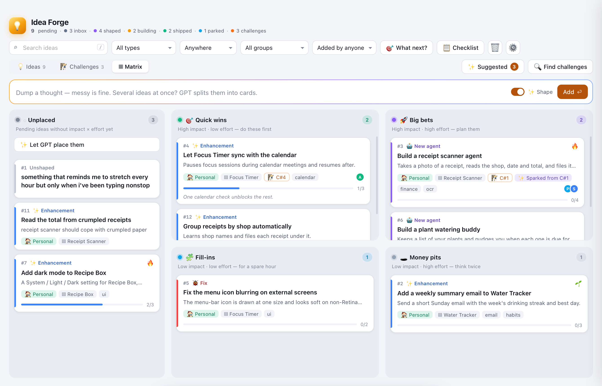
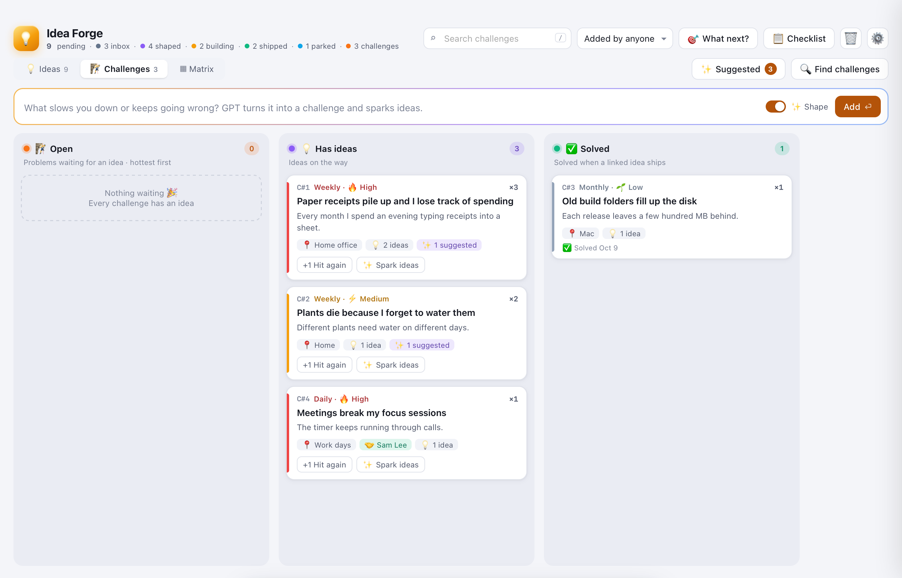
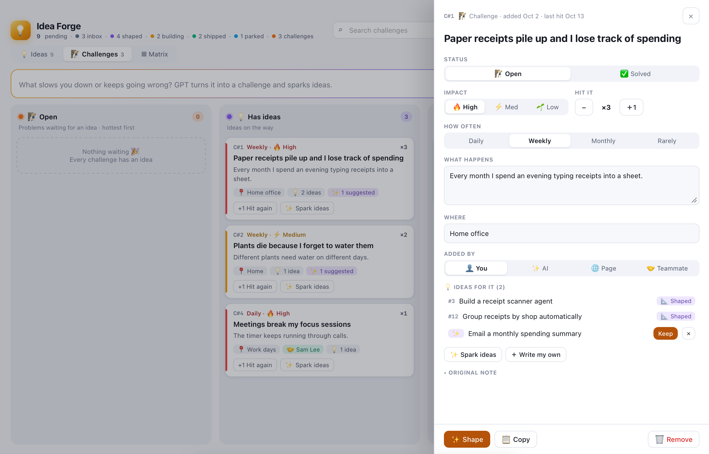
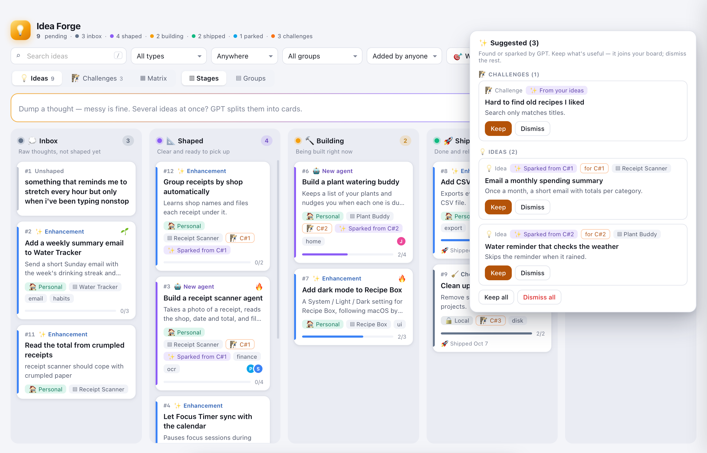
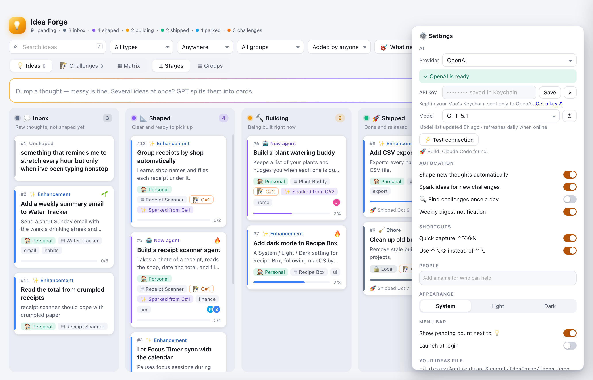

# 💡 Idea Forge

A Mac menu-bar backlog for the apps and AI agents you want to build next, and for the problems that
make you want to build them.

Drop in a messy thought. The AI of your choice turns it into a clear card with a title, what it does, why it
matters, build steps and who could help. Then drag the card from **Inbox → Shaped → Building → Shipped**.
Write down what slows you down as a 🧗 challenge, and Idea Forge sparks ideas to solve it.


## Install

1. Download **IdeaForge-x.y.z.dmg** from [Releases](https://github.com/Sravankumartangudu/idea-forge/releases/latest).
2. Open it and drag **Idea Forge** onto **Applications**.
3. Open it from Applications. Apple hasn't notarized it, so the first time macOS says it can't be
   verified. To open it: **System Settings › Privacy & Security** → scroll down → **Open Anyway**.
   You only do this once.
4. Optional: pick an AI in **⚙︎ Settings** (see [Choosing an AI](#choosing-an-ai)). Without one, everything
   else works and you fill in cards by hand.

Idea Forge lives in the menu bar as 💡 next to your pending count. It needs macOS 13 or later and
runs on Apple silicon and Intel. It never reads your screen, your browser or other apps.

## Choosing an AI

In **⚙︎ Settings › AI**, pick a provider:

| Provider | What you need |
|---|---|
| **Claude Code** (installed app) | [Claude Code](https://claude.com/claude-code), signed in. No key. |
| **Anthropic** · Claude API | An API key. |
| **OpenAI** | An API key. |
| **Google Gemini** | An API key. |
| **OpenRouter** | One key for many models. |
| **Ollama** | Ollama running on this Mac. Free, and nothing leaves the Mac. |
| **OpenAI-compatible** | LM Studio, Groq, Mistral or any server with an OpenAI-style API. Set the server address; the key is optional. |

- **Keys** are kept in your Mac's Keychain, never in a file, and are sent only to the provider they belong to.
- **Models**: the model list loads live from the provider, so new models show up without an app update.
  It refreshes once a day when you're online, or press ↻. **Other…** takes any model id.
- **⚡ Test connection** sends one short request so you know the setup works.

## Using it

| | |
|---|---|
| **Add a thought** | Type anything in the box at the top and press Return. If it holds several ideas, the AI splits them into separate cards. Turn off ✨ Shape to add a card as typed. |
| **Quick capture** | Press **⌃⌥N** anywhere for a small box that adds an idea or a challenge without opening the board. If another app already uses those keys, switch to ⌃⌥⇧N in Settings. |
| **Move cards** | Drag a card between columns, or up and down to set the order. You can also change the stage in the card's drawer. |
| **Open a card** | Click it. You can edit the title, type, priority, where it ships, which app it's for, its group, steps, who can help and tags. |
| **💬 Ask** | In a card's drawer, ask anything, or use a preset: 🧭 *Make a build plan*, ⚠️ *What could go wrong?*, ✂️ *Smallest version* or 🤝 *Who could help?*. **Use as build steps** puts an answer's steps on the card. |
| **🎯 What next?** | The AI reads the whole board and picks up to three ideas to do next, with a reason for each. |
| **🔁 Looks like #n** | While shaping, the AI links a new card to close matches already on the board, so you can merge instead of adding twice. |
| **🚀 Build** | Opens Terminal with a Claude Code or Codex session (whichever you have installed) that already has the card as its brief. It starts in the app's folder for an enhancement. The card moves to Building. |
| **🐙 Open as issue** | When the card is for one of your apps with a GitHub repo, opens a new issue there, filled with the card. |
| **Remove** | Use 🗑 Remove in the drawer, or **Select** several cards and remove them together. Removed cards go to the 🗑 bin, where you can restore them. |
| **Checklist** | 📋 Checklist copies all pending ideas as a Markdown checklist (`- [ ] #3 Build a receipt scanner agent`). |
| **Copy brief** | Copies one idea as a short Markdown brief to send to someone who can help. |
| **Find** | Press `/` to search. You can also filter by type, where it ships, group, or who added it. |



### Columns

💭 **Inbox** holds raw thoughts. 📐 **Shaped** cards are clear and ready to pick up. 🔨 **Building** cards are in progress.
🚀 **Shipped** cards are done. 🧊 **Parked** cards are for not now, maybe later.

### Groups

One big plan often brings many ideas: say you want to build a receipt-scanner agent, and you keep
thinking of things it should do. Give those cards the same **group** and they stay together.

- Switch the board from **Stages** to **Groups** to see one column per group, with ＋ **New group** at the end.
- When shaping, the AI puts a new idea into a group that already fits it. An enhancement for an app with
  no group falls under that app's name.
- Click a group chip on any card to show only that group.



### 🧗 Challenges

A challenge is a problem rather than a solution: something slow, repeated or annoying. Add one in the
**Challenges** tab or with ⌃⌥N. The AI shapes it (what happens, where, how often, how much it hurts) and
sparks ideas that would solve it.

- Challenges sit in three columns: 🧗 **Open** (no idea yet, hottest first), 💡 **Has ideas** and ✅ **Solved**.
  A challenge is solved when one of its ideas ships.
- **Heat** is impact × how often × times hit. Hit the same problem again and the AI adds a hit to the
  existing challenge instead of writing a new one.
- **🔍 Find challenges** looks through TODO and FIXME notes in your app folders and the open issues on
  your public GitHub repos, and suggests challenges from what keeps coming back.





### Who added it

Every idea and challenge shows where it came from: 👤 **You**, ✨ **AI** (for example "Sparked from C#2")
or 🤝 **Teammate** (with their name). You can change it in the drawer and filter the board by it.

### ✨ Suggested

What the AI comes up with on its own waits in the ✨ **Suggested** tray. It never goes straight onto your
board. **Keep** what's useful and **Dismiss** the rest.



### ⊞ Matrix

The **Matrix** tab places pending ideas by impact and effort: 🎯 **Quick wins**, 🚀 **Big bets**,
🧩 **Fill-ins** and 🕳️ **Money pits**. Drag a card to another square, or let the AI place the unplaced ones.


### Card fields

- **Type**: 🤖 New agent, ✨ Enhancement, 🐞 Fix or 🧹 Chore.
- **Priority**: 🔥 High, ⚡ Medium or 🌱 Low.
- **Where it ships**:
  - 🏠 **Personal**: a public repo that anyone can use and help build.
  - 💼 **Work**: your work's git.
  - 🔒 **Local**: stays on this Mac.
- **For app**: the app an enhancement is for. Leave it empty for a brand-new agent. Idea Forge suggests
  apps it finds in your home folder: any folder with a `build.sh` or `package.json`. Where an app ships comes from its git remote: github.com is personal, any other host is work, and no remote is local.
- **Group**: cards that belong together (see [Groups](#groups)).
- **🤝 Who can help**: people to ask or hand the idea to. They show as avatars on the card. Add names
  you use often in Settings › People.

### Settings (⚙︎)

- **AI**: provider, key, model and ⚡ Test connection.
- **Automation**: shape new thoughts automatically (on), spark ideas for new challenges (on),
  🔍 Find challenges once a day (off) and a weekly digest notification (on). The digest comes on Monday,
  with what you added and shipped and your hottest open challenge.
- **Shortcuts**: ⌃⌥N quick capture on or off, or ⌃⌥⇧N instead.
- **People**: names for Who can help.
- **Appearance**: System, Light or Dark.
- **Menu bar**: show or hide the pending count, and launch at login.
- **Your ideas file**: Show in Finder, or **Choose folder…** to keep it somewhere else, such as iCloud Drive.
- **Updates**: Idea Forge checks GitHub for a newer release and shows a Download button when one is out.



## Your data

Your ideas and challenges live in a single JSON file on your Mac:

```
~/Library/Application Support/IdeaForge/ideas.json
```

You can move it to any folder from Settings. Idea Forge watches the file, so edits made by another tool
or an AI assistant appear on the board right away.

Nothing leaves your Mac except the text you choose to send to the AI you picked. With Claude Code, that
goes through your own sign-in. With Ollama, it never leaves the Mac at all. 🔍 Find challenges reads
only your app folders and your public GitHub issues.

```json
{ "version": 1,
  "ideas": [ {
    "id": "…", "n": 3, "title": "Build a receipt scanner agent",
    "summary": "…", "why": "…", "raw": "the thought as you typed it",
    "type": "agent | enhancement | fix | chore",
    "status": "inbox | shaped | building | shipped | parked | suggested | removed",
    "priority": "high | med | low", "home": "personal | work | local", "app": "", "group": "Receipt Scanner",
    "impact": "high | low", "effort": "high | low", "challenge": "c… (the challenge it solves)",
    "origin": { "by": "you | ai | teammate", "name": "", "label": "Sparked from C#1" },
    "steps": [ { "t": "Read text from a photo", "done": false } ],
    "helpers": ["Priya"], "tags": ["finance"], "order": 3,
    "created": "2026-10-03T09:00:00Z", "updated": "…"
  } ],
  "challenges": [ {
    "id": "c…", "n": 1, "title": "Typing receipts into a spreadsheet by hand",
    "detail": "…", "where": "", "raw": "…",
    "often": "daily | weekly | monthly | rare", "impact": "high | med | low", "hits": 1,
    "status": "open | solved | suggested | removed", "origin": { "by": "you" },
    "created": "…", "updated": "…"
  } ] }
```

`n` is the card's number, shown as `#3` for ideas and `C#1` for challenges. A new card gets one more than
the highest number on the board. Suggestions have no number until you keep them.

## Build from source

```bash
git clone https://github.com/Sravankumartangudu/idea-forge && cd idea-forge
./build.sh            # builds IdeaForge.app for this Mac
./package.sh          # universal build + dist/IdeaForge-<version>.dmg
open IdeaForge.app --args --demo     # sample board, never saves
```

| Flag | What it does |
|---|---|
| `--board` | Opens the board at launch. |
| `--demo` | Loads `demo.json` into memory and never writes to disk. Useful for screenshots. |
| `--checklist` | Prints the pending list as a Markdown checklist and quits. |

The app is plain Swift and AppKit with no dependencies. The board is a single `board.html` page in a WKWebView.

| File | What it is |
|---|---|
| `main.swift` | The app: menu bar, board window, ideas file, settings. |
| `AI.swift` | The AI providers, live model lists and Keychain keys. |
| `Extras.swift` | Hotkeys, quick capture, notifications, the weekly digest, the update check and 🔍 Find's local signals. |
| `Edition.swift` | Everything that sets this edition apart. |
| `board.html`, `demo.json` | The board and its sample data. |

## License

[MIT](LICENSE) © 2026 Sravankumar Tangudu
